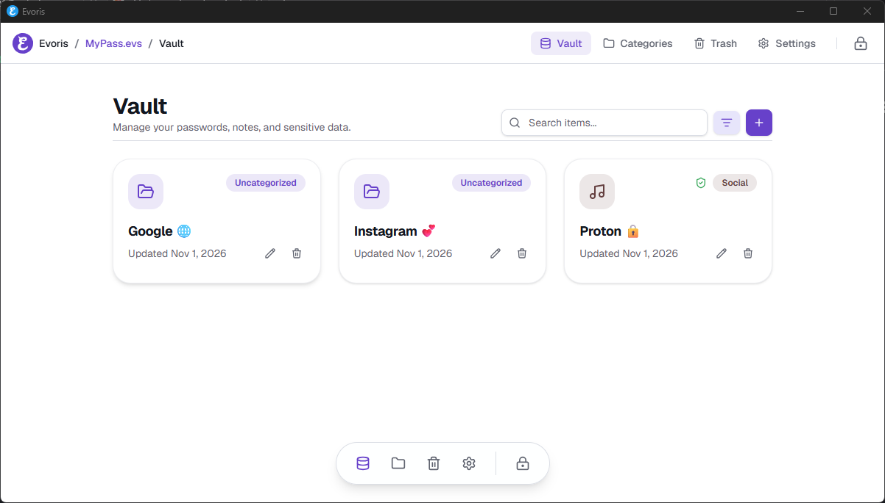

<div align="center">

  <h1>
    
    Evoris
  </h1>
  <p><strong>A private, fully offline, open-source password manager.</strong></p>
  <p>
    <a href="https://github.com/miangee21/Evoris/releases/latest">
      
    </a>
    <a href="https://github.com/miangee21/Evoris/blob/master/LICENSE">
      
    </a>
    
    
    
    
  </p>

  <p>
    <a href="#-installation">📦 Install</a> ·
    <a href="#-features">✨ Features</a> ·
    <a href="#-security--cryptography-architecture">🛡️ Security</a> ·
    <a href="#-the-evs-file-specification">🔐 Vault Format</a> ·
    <a href="#-tech-stack">⚡ Tech Stack</a> ·
    <a href="#-building-from-source">🔨 Build</a> ·
    <a href="#-project-structure">🗂️ Structure</a> ·
    <a href="#-contributing">🤝 Contribute</a> ·
    <a href="https://github.com/miangee21/Evoris" target="_blank" rel="noopener noreferrer">🌐 GitHub</a>
  </p>

  <br />
  

</div>

<br />

---

## Table of Contents

- [Overview](#-overview)
- [Why Evoris?](#-why-evoris)
- [Key Features](#-features)
  - [Zero-Trust Local Encryption](#zero-trust-local-encryption)
  - [Dynamic Custom Field Engine](#dynamic-custom-field-engine)
  - [Embedded TOTP / 2FA Authenticator](#embedded-totp--2fa-authenticator)
  - [Encrypted File Attachments](#encrypted-file-attachments)
  - [Smart Categorization & Search](#smart-categorization--search)
  - [Trash & Soft-Delete Safeguards](#trash--soft-delete-safeguards)
  - [Memory Hygiene & Idle Auto-Lock](#memory-hygiene--idle-auto-lock)
  - [Atomic Persistence & Data Integrity](#atomic-persistence--data-integrity)
  - [Customizable Experience & Themes](#customizable-experience--themes)
- [Security & Cryptography Architecture](#-security--cryptography-architecture)
  - [Argon2id Key Derivation](#1-argon2id-key-derivation)
  - [AES-256-GCM with Authenticated Additional Data (AAD)](#2-aes-256-gcm-authenticated-encryption)
  - [Zero-Leak Memory Management](#3-zero-leak-memory-management)
  - [Network & IPC Boundaries](#4-network--ipc-boundaries)
- [The `.evs` File Specification](#-the-evs-file-specification)
- [Export & Import System](#-export--import-system)
- [Tech Stack](#-tech-stack)
- [Installation](#-installation)
  - [Windows](#windows)
  - [Linux](#linux)
- [Building from Source](#-building-from-source)
  - [Prerequisites](#prerequisites)
  - [Development Workflow](#development-workflow)
  - [Quality Checks](#quality-checks)
  - [Production Build](#production-build)
- [Project Structure](#-project-structure)
- [Contributing](#-contributing)
- [Security Disclosure](#-security-disclosure)
- [Roadmap](#-roadmap)
- [License](#-license)

---

## 📖 Overview

**Evoris** is an uncompromising, fully offline, open-source desktop password manager. It is engineered from the ground up for individuals who refuse to trust third-party cloud infrastructure with their master credentials.

In Evoris, every category, credential, attachment, and secret is encapsulated in a single, self-contained binary vault file (`.evs`). There are **no cloud accounts, no sync daemons, no background analytics, no telemetry, and zero outbound network calls**. Your vault remains entirely under your sovereign control.

Built on **Tauri v2** (Rust + Native WebView), Evoris combines the high-performance memory safety of a compiled Rust core with a fluid, accessible interface powered by **React 19**, **Tailwind CSS v4**, and **shadcn/ui**.

---

## 💡 Why Evoris?

| Vulnerability Vector | Traditional Cloud Password Managers | Evoris Local Vault |
|---|---|---|
| **Storage Location** | Remote cloud databases & S3 buckets | Solely on your local filesystem (`.evs`) |
| **Network Exposure** | Continuous sync API endpoints | **Zero network requests** (air-gapped by design) |
| **Telemetry & Tracking** | User analytics, crash reporters, pingbacks | **None.** No analytics, no tracking, no logs |
| **Master Key Custody** | Stored or validated across network endpoints | Key derived and zeroized in Rust RAM only |
| **Autofill Attack Surface** | Browser extensions exposed to DOM injection | **No browser autofill** — secure clipboard buffer |
| **Process Footprint** | Bloated multi-hundred-megabyte Electron apps | Lightweight, memory-efficient native Tauri binary |

---

## ✨ Features

### Zero-Trust Local Encryption
- Single-file encrypted container (`.evs`) locked behind your master password.
- Cryptographically verified using **Argon2id** key derivation (64 MiB RAM, 3 iterations, 4 lanes) and **AES-256-GCM** authenticated cipher.
- Tamper-evident 33-byte header bound directly to the encryption payload as Authenticated Additional Data (AAD).

### Dynamic Custom Field Engine
- Build custom credential layouts per item without arbitrary constraints.
- Supported field types:
  - **Text**: Standard plaintext input.
  - **Password**: Masked input with one-click reveal toggle and copy helper.
  - **Email**: Formatted email address.
  - **URL**: Web link with verified launch prompt.
  - **Notes**: Full Markdown formatted notes.
  - **Section Headings**: Visual dividers to structure complex records.
- Effortlessly reorder fields via drag-and-drop handles or keyboard-friendly directional arrows.

### Embedded TOTP / 2FA Authenticator
- Generate time-based one-time passwords directly within each vault entry (RFC 6238 compliant: SHA-1, 6 digits, 30s period).
- Real-time SVG circular countdown ring provides instant visual indicator before code expiration.
- Instant one-click code copy to clipboard.

### Encrypted File Attachments
- Store sensitive recovery keys, SSH identities, and certificates directly inside the encrypted vault.
- Attachments are base64-serialized and encrypted within the single `.evs` payload.
- Zero leftover cache or disk residue when inspecting or exporting attachments.

### Smart Categorization & Search
- Organize vaults into custom categories with 30 curated Lucide icons and vibrant custom hex accents.
- Responsive grid view with fast real-time search.
- **Privacy-first search indexing:** Queries only match item names, strictly avoiding field values, secrets, or notes to prevent memory and timing side-channel leakage.

### Trash & Soft-Delete Safeguards
- Accidents happen: deleted items are staged in a dedicated Trash view with timestamps.
- Restore items back to their original state with a single click.
- Permanently purge individual items or empty the entire trash buffer in one atomic operation.

### Memory Hygiene & Idle Auto-Lock
- Auto-locks automatically after inactivity (configurable: 10s, 15s, 20s, 30s, 1m, 3m, 5m, or Off; default 30s).
- Instant manual lock button available in top and dock navigation.
- Clipboard buffer automatically scrubs copied passwords after 60 seconds, or immediately upon vault lock.
- Sensitive memory is wiped using `zeroize` upon lock.

### Atomic Persistence & Data Integrity
- Every vault write follows an atomic sequence: write to `.evs.tmp` &rarr; physical hardware sync (`sync_all` / `fsync`) &rarr; atomic filesystem rename.
- Eliminates file corruption risks from unexpected power loss, OS crashes, or write interruptions.

### Customizable Experience & Themes
- Built-in Dark and Light modes with 6 refined accent palettes (Violet, Blue, Emerald, Rose, Amber, Zinc).
- Navigation modes tailored to your screen: clean **Top Bar** or convenient **Bottom Dock**.
- Appearance settings are stored locally on the device (never in the vault), ensuring unlocking or switching vaults never resets your personal theme.

---

## 🛡️ Security & Cryptography Architecture

Evoris is engineered with defense-in-depth principles. The encryption engine resides exclusively in compiled Rust code (`src-tauri/src/crypto/` and `src-tauri/src/vault/`).

```
Master Password + Random Salt (16 bytes)
                  │
                  ▼
         [ Argon2id KDF ]  ◄── 64 MiB RAM, 3 iterations, 4 lanes
                  │
                  ▼
       256-bit DerivedKey (Held strictly in Rust memory; Zeroized on drop)
                  │
                  ▼
  [ AES-256-GCM Authenticated Encryption ]
  ├── Nonce: 12 bytes CSPRNG
  ├── Plaintext: Serialized Vault JSON
  └── AAD (33 bytes): Magic "EVOR" (4B) + Version 0x01 (1B) + Salt (16B) + Nonce (12B)
                  │
                  ▼
   Tamper-Proof .evs Container
```

### 1. Argon2id Key Derivation
- **Algorithm:** Argon2id (RFC 9106), combining data-dependent and data-independent memory access to defend against both GPU brute-force attacks and side-channel timing analysis.
- **Parameters:**
  - Memory: `65,536 KiB` (64 MiB)
  - Iterations: `3`
  - Parallelism: `4` threads
  - Output Key Length: `32 bytes` (256 bits)

### 2. AES-256-GCM Authenticated Encryption
- **Cipher:** AES-256 in Galois/Counter Mode (GCM).
- **Nonce:** 96-bit (12 bytes) cryptographically secure random value generated per write via `rand_core` / OS CSPRNG. Nonces are never reused.
- **Authenticated Additional Data (AAD):** The entire 33-byte file header (Magic bytes + Version byte + Salt + Nonce) is authenticated alongside the ciphertext. Any modification to the header or ciphertext will immediately fail verification with `VaultError::DecryptionFailed`.

### 3. Zero-Leak Memory Management
- **Zeroization:** The `DerivedKey` struct implements `zeroize::ZeroizeOnDrop`. When the key is dropped or the vault is locked, memory is overwritten with zeroes.
- **RAM Scrubbing:** On lock, all in-memory item vectors, category collections, and salt buffers are explicitly cleared (`clear()` and `zeroize()`).
- **No IPC Exposure:** The raw cryptographic key is never sent over the Tauri IPC channel to the frontend JavaScript runtime. The WebView only ever handles decrypted UI data while unlocked.

### 4. Network & IPC Boundaries
- **No Inbound/Outbound Networking:** Evoris contains no HTTP clients (`fetch`, `reqwest`, `axios`).
- **Safe Markdown Rendering:** Notes are rendered using strict React markdown with raw HTML disabled, external image loading stripped, and links unclickable inline.
- **Explicit URL Confirmation:** Outgoing web links are never opened automatically. Clicking an external URL triggers an explicit user confirmation dialog, which hands off the URL to the default OS browser via `@tauri-apps/plugin-opener`.

---

## 🔐 The `.evs` File Specification

Evoris stores all vault state inside a compact, tamper-resistant binary layout:

```
+----------------+----------------+------------------+-------------------+----------------------------+
|  Magic Bytes   | Format Version |  Argon2id Salt   |   AES-GCM Nonce   |   AES-256-GCM Ciphertext   |
|   (4 Bytes)    |    (1 Byte)    |    (16 Bytes)    |    (12 Bytes)     |       (N Bytes)            |
|     "EVOR"     |      0x01      |  CSPRNG Random   |   CSPRNG Random   | Encrypted Vault JSON + Tag |
+----------------+----------------+------------------+-------------------+----------------------------+
|<--------------------------- 33-Byte AAD Header ----------------------->|
```

| Offset (Bytes) | Field | Size | Description |
|---|---|---|---|
| `0x00 - 0x03` | Magic Number | 4 Bytes | ASCII bytes `b"EVOR"` (`0x45 0x56 0x4F 0x52`) |
| `0x04` | Format Version | 1 Byte | Current format version `0x01` |
| `0x05 - 0x14` | Salt | 16 Bytes | Cryptographically secure random salt for Argon2id |
| `0x15 - 0x20` | Nonce | 12 Bytes | Unique initialization vector for AES-256-GCM |
| `0x21 - End` | Ciphertext | Variable | Encrypted JSON data payload with 16-byte Poly1305 authentication tag appended |

---

## 📦 Export & Import System

Evoris supports backup and migration through a strict, transparent JSON interchange format:

```json
{
  "format": "evoris-export",
  "formatVersion": 1,
  "exportedAt": "2026-11-01T21:00:00Z",
  "vaultName": "PrimaryVault",
  "categories": [ ... ],
  "items": [ ... ],
  "trash": [ ... ]
}
```

> [!WARNING]
> **Exported JSON files are completely unencrypted by design.** Anyone who accesses an exported `.json` file can read your secrets in plaintext. Store exports on encrypted storage and delete them immediately after migration. For an encrypted backup, simply copy your `.evs` vault file!

- **Atomic Import:** Importing always creates a **brand-new `.evs` vault file** with a newly defined master password and fresh UUIDs.
- **Strict Validation:** Only Evoris schema v1 files are accepted. Partial or corrupted imports are rejected to prevent vault contamination.

---

## ⚡ Tech Stack

```
┌─────────────────────────────────────────────────────────────┐
│                    Desktop UI (WebView)                     │
│  React 19  │  TypeScript  │  Tailwind CSS v4  │  shadcn/ui  │
│  Zustand   │  React Hook Form + Zod  │  Framer Motion       │
└──────────────────────────────┬──────────────────────────────┘
                               │ Tauri IPC (Strongly Typed)
┌──────────────────────────────▼──────────────────────────────┐
│                     Core Runtime (Rust)                     │
│  Tauri v2  │  Argon2id (KDF)  │  AES-256-GCM (Cipher)        │
│  Zeroize   │  Serde JSON      │  Atomic File I/O (fsync)    │
└─────────────────────────────────────────────────────────────┘
```

| Layer | Technologies | Purpose |
|---|---|---|
| **Core Desktop Engine** | [Tauri v2](https://v2.tauri.app) | Secure, lightweight native window and OS binding |
| **Backend Language** | [Rust](https://www.rust-lang.org) (2021 edition) | High-speed, memory-safe cryptographic and vault I/O operations |
| **Cryptography** | `argon2`, `aes-gcm`, `zeroize`, `getrandom` | Industry-standard key derivation, authenticated encryption, and memory scrubbing |
| **Frontend Framework** | [React 19](https://react.dev), [Vite 8](https://vite.dev) | Modern reactive interface with fast rendering and modularity |
| **State & Navigation** | [Zustand 5](https://zustand.docs.pmnd.rs), [React Router 7](https://reactrouter.com) | Predictable client state management and route guards |
| **Styling & Components** | [Tailwind CSS v4](https://tailwindcss.com), [Base UI](https://base-ui.com), [Lucide Icons](https://lucide.dev) | CSS variable-driven design tokens and accessible primitives |
| **Schema & Forms** | [Zod 4](https://zod.dev), [React Hook Form](https://react-hook-form.com) | Strict boundary schema validation across all inputs and IPC payloads |

---

## 📦 Installation

Pre-compiled binary packages are available on the [Releases page](https://github.com/miangee21/Evoris/releases/latest).

### Windows
Download the latest Windows installer:
- `.msi` (Windows Installer)
- `.exe` (Standard standalone setup)

Run the installer and follow the setup wizard. Evoris will install cleanly without background services or auto-starters.

### Linux
Download the package corresponding to your distribution:

| Format | Supported Distributions | Installation Command |
|---|---|---|
| **AppImage** | Universal (All distributions) | `chmod +x Evoris_*.AppImage && ./Evoris_*.AppImage` |
| **Debian / Ubuntu** | Ubuntu, Debian, Linux Mint, Pop!_OS | `sudo dpkg -i evoris_*_amd64.deb` |
| **RPM** | Fedora, RHEL, openSUSE | `sudo rpm -i evoris-*.x86_64.rpm` |

---

## 🔨 Building from Source

### Prerequisites
1. **Node.js**: `v20.x` or higher and `npm`
2. **Rust**: Latest stable toolchain via [rustup](https://rustup.rs/)
3. **Platform Build Tools**:
   - **Windows:** Visual Studio 2022 with C++ Build Tools & WebView2
   - **Linux:** `build-essential`, `libwebkit2gtk-4.1-dev`, `libssl-dev`, `libappindicator3-dev`, `librsvg2-dev`

### Development Workflow

Clone the repository and install dependencies:

```bash
git clone https://github.com/miangee21/Evoris.git
cd Evoris
npm ci
```

Start the interactive development environment:

```bash
npm run dev
```

Run both the Vite dev server and Tauri desktop window concurrently:

```bash
npm run tauri dev
```

### Quality Checks

Evoris enforces strict code hygiene. Before committing code, run the full test suite:

```bash
# Runs TypeScript typecheck, ESLint, and Cargo Clippy with zero warnings allowed
npm run check:all

# Run Rust unit tests and verify formatting
cd src-tauri && cargo test && cargo fmt --check && cd ..
```

### Production Build

Compile native release binaries:

```bash
npm run tauri build
```

Compiled binaries and distribution bundles will be located in:
- `src-tauri/target/release/bundle/`

---

## 🗂️ Project Structure

Evoris enforces a strict, modular **feature-based architecture**. Each feature encapsulates its own components, hooks, stores, schemas, and API wrappers:

```
Evoris/
├── .github/
│   ├── pics/
│   │   ├── icon.png
│   │   └── home.png
│   └── workflows/
│       └── release.yml
├── .vscode/
│   └── extensions.json
├── public/
│   └── home-doodle.svg
│ 
├── src/
│   ├── main.tsx
│   ├── App.tsx
│   ├── vite-env.d.ts
│   │
│   ├── app/                                # app-level wiring only
│   │   ├── router/
│   │   │   ├── routes.tsx
│   │   │   ├── route-paths.ts
│   │   │   └── guards/
│   │   │       ├── require-unlocked.tsx
│   │   │       └── require-locked.tsx
│   │   ├── providers/
│   │   │   ├── app-providers.tsx
│   │   │   ├── theme-provider.tsx
│   │   │   └── error-boundary.tsx
│   │   └── layouts/
│   │       ├── vault-layout.tsx
│   │       └── standalone-layout.tsx
│   │
│   ├── features/
│   │   ├── splash/
│   │   │   ├── components/
│   │   │   │   └── splash-screen.tsx
│   │   │   └── hooks/
│   │   │       └── use-splash-timer.ts
│   │   │
│   │   ├── home/
│   │   │   ├── components/
│   │   │   │   ├── home-screen.tsx
│   │   │   │   ├── home-settings-dialog.tsx
│   │   │   │   ├── home-action-card.tsx
│   │   │   │   ├── password-checklist.tsx
│   │   │   │   ├── vault-mascot-panel.tsx
│   │   │   │   ├── open-vault-dialog.tsx
│   │   │   │   ├── create-vault-dialog.tsx
│   │   │   │   └── import-vault-dialog.tsx
│   │   │   ├── hooks/
│   │   │   │   ├── use-blob-companion.ts
│   │   │   │   ├── use-open-vault.ts
│   │   │   │   └── use-create-vault.ts
│   │   │   └── schemas/
│   │   │       ├── open-vault.schema.ts
│   │   │       └── create-vault.schema.ts
│   │   │
│   │   ├── vault-session/                  # unlock state, in-memory vault, lock
│   │   │   ├── components/
│   │   │   │   └── unlock-screen.tsx 
│   │   │   ├── store/
│   │   │   │   ├── session.store.ts
│   │   │   │   └── session.selectors.ts
│   │   │   ├── hooks/
│   │   │   │   ├── use-session.ts
│   │   │   │   ├── use-lock-vault.ts
│   │   │   │   └── use-unlock-vault.ts
│   │   │   ├── api/
│   │   │   │   └── vault.commands.ts        # typed Tauri invoke wrappers
│   │   │   └── types/
│   │   │       └── session.types.ts
│   │   │
│   │   ├── autolock/
│   │   │   ├── hooks/
│   │   │   │   ├── use-idle-timer.ts
│   │   │   │   └── use-autolock.ts
│   │   │   └── constants/
│   │   │       └── autolock-options.ts
│   │   │
│   │   ├── items/
│   │   │   ├── api/
│   │   │   │   └── item.commands.ts
│   │   │   ├── components/
│   │   │   │   ├── items-page.tsx
│   │   │   │   ├── item-card.tsx
│   │   │   │   ├── item-grid.tsx
│   │   │   │   ├── item-category-filter.tsx
│   │   │   │   ├── item-empty-state.tsx
│   │   │   │   ├── item-detail-page.tsx
│   │   │   │   ├── item-detail-header.tsx
│   │   │   │   ├── item-view-mode.tsx
│   │   │   │   ├── item-edit-mode.tsx
│   │   │   │   └── item-create-page.tsx
│   │   │   ├── hooks/
│   │   │   │   ├── use-item-mutations.ts
│   │   │   │   └── use-item-search.ts
│   │   │   └── schemas/
│   │   │       └── item.schema.ts
│   │   │
│   │   ├── fields/                          # dynamic field engine
│   │   │   ├── components/
│   │   │   │   ├── field-list.tsx
│   │   │   │   ├── field-row.tsx
│   │   │   │   ├── add-field-menu.tsx
│   │   │   │   ├── field-reorder-handle.tsx
│   │   │   │   ├── field-reorder-arrows.tsx
│   │   │   │   ├── field-row-edit.tsx
│   │   │   │   ├── field-renderer-select.ts
│   │   │   │   └── renderers/
│   │   │   │       ├── heading-field.tsx
│   │   │   │       ├── text-field.tsx
│   │   │   │       ├── url-field.tsx
│   │   │   │       ├── email-field.tsx
│   │   │   │       ├── password-field.tsx
│   │   │   │       └── notes-field.tsx
│   │   │   ├── hooks/
│   │   │   │   └── use-field-reorder.ts
│   │   │   ├── schemas/
│   │   │   │   └── field.schema.ts
│   │   │   ├── constants/
│   │   │   │   └── field-types.ts
│   │   │   └── lib/
│   │   │       ├── renumber-fields.ts
│   │   │       └── field-paths.ts
│   │   │
│   │   ├── password-generator/
│   │   │   ├── components/
│   │   │   │   ├── password-generator-modal.tsx
│   │   │   │   ├── generator-length-slider.tsx
│   │   │   │   ├── generator-toggles.tsx
│   │   │   │   └── generator-preview.tsx
│   │   │   ├── lib/
│   │   │   │   ├── generate-password.ts
│   │   │   │   └── character-sets.ts
│   │   │   └── types/
│   │   │       └── generator.types.ts
│   │   │
│   │   ├── totp/
│   │   │   ├── components/
│   │   │   │   ├── totp-badge.tsx
│   │   │   │   ├── totp-countdown-ring.tsx
│   │   │   │   ├── add-totp-dialog.tsx
│   │   │   │   ├── totp-section.tsx
│   │   │   │   └── edit-totp-dialog.tsx
│   │   │   ├── hooks/
│   │   │   │   └── use-totp-code.ts
│   │   │   ├── lib/
│   │   │   │   ├── base32.ts
│   │   │   │   └── totp.ts
│   │   │   ├── schemas/
│   │   │   │   └── totp.schema.ts
│   │   │   └── constants/
│   │   │       └── totp-config.ts
│   │   │
│   │   ├── categories/
│   │   │   ├── api/
│   │   │   │   └── category.commands.ts
│   │   │   ├── components/
│   │   │   │   ├── categories-page.tsx
│   │   │   │   ├── category-grid.tsx
│   │   │   │   ├── category-card.tsx
│   │   │   │   ├── category-form-modal.tsx
│   │   │   │   ├── category-icon-picker.tsx
│   │   │   │   └── category-color-picker.tsx
│   │   │   ├── hooks/
│   │   │   │   ├── use-categories.ts
│   │   │   │   └── use-category-mutations.ts
│   │   │   ├── schemas/
│   │   │   │   └── category.schema.ts
│   │   │   ├── lib/
│   │   │   │   └── category-display.ts
│   │   │   ├── constants/
│   │   │   │   └── category-icons.ts         # the 30 lucide icons
│   │   │   └── types/
│   │   │       └── category.types.ts
│   │   │
│   │   ├── trash/
│   │   │   ├── api/
│   │   │   │   └── trash.commands.ts
│   │   │   ├── components/
│   │   │   │   ├── trash-page.tsx
│   │   │   │   ├── trash-list.tsx
│   │   │   │   ├── trash-row.tsx
│   │   │   │   ├── trash-search-bar.tsx
│   │   │   │   └── empty-trash-button.tsx
│   │   │   └── hooks/
│   │   │       └── use-trash-mutations.ts
│   │   │
│   │   ├── settings/
│   │   │   ├── components/
│   │   │   │   ├── settings-page.tsx
│   │   │   │   ├── settings-section.tsx
│   │   │   │   ├── appearance-section.tsx
│   │   │   │   ├── theme-selector.tsx
│   │   │   │   ├── accent-selector.tsx
│   │   │   │   ├── navigation-section.tsx
│   │   │   │   ├── vault-section.tsx
│   │   │   │   ├── change-master-password-form.tsx
│   │   │   │   ├── autolock-selector.tsx
│   │   │   │   ├── export-section.tsx
│   │   │   │   └── about-section.tsx
│   │   │   ├── hooks/
│   │   │   │   ├── use-vault-settings.ts
│   │   │   │   └── use-change-master-password.ts
│   │   │   ├── constants/
│   │   │   │   └── settings-defaults.ts
│   │   │   └── types/
│   │   │       └── settings.types.ts
│   │   │
│   │   ├── theme/
│   │   │   ├── hooks/
│   │   │   │   ├── use-theme.ts
│   │   │   │   └── use-accent.ts
│   │   │   ├── lib/
│   │   │   │   └── apply-theme.ts
│   │   │   ├── store/
│   │   │   │   └── theme.store.ts
│   │   │   ├── constants/
│   │   │   │   ├── themes.ts
│   │   │   │   └── accents.ts
│   │   │   └── types/
│   │   │       └── theme.types.ts
│   │   │
│   │   ├── navigation/
│   │   │   ├── components/
│   │   │   │   ├── top-bar.tsx
│   │   │   │   ├── top-bar-breadcrumb.tsx
│   │   │   │   ├── top-bar-nav.tsx
│   │   │   │   ├── lock-button.tsx
│   │   │   │   └── bottom-dock.tsx
│   │   │   ├── hooks/
│   │   │   │   └── use-navigation-mode.ts
│   │   │   └── constants/
│   │   │       └── nav-items.ts
│   │   │
│   │   ├── clipboard/
│   │   │   ├── hooks/
│   │   │   │   └── use-copy-to-clipboard.ts
│   │   │   └── lib/
│   │   │       └── clipboard.ts
│   │   │
│   │   ├── attachments/
│   │   │   ├── components/
│   │   │   │   └── attachments-section.tsx
│   │   │   └── lib/
│   │   │       └── attachments.ts
│   │   │
│   │   └── export-import/
│   │       ├── components/
│   │       │   ├── export-button.tsx
│   │       │   └── import-wizard.tsx
│   │       ├── hooks/
│   │       │   ├── use-export-vault.ts
│   │       │   └── use-import-vault-file.ts
│   │       ├── schemas/
│   │       │   ├── import-vault.schema.ts
│   │       │   └── export-payload.schema.ts
│   │       └── types/
│   │           └── export.types.ts
│   │
│   ├── shared/
│   │   ├── components/
│   │   │   ├── ui/                           # shadcn/ui + base-ui (generated)
│   │   │   ├── confirm-dialog.tsx            # shared confirmation dialog
│   │   │   ├── page-header.tsx
│   │   │   ├── page-container.tsx
│   │   │   ├── password-input.tsx
│   │   │   ├── copy-button.tsx
│   │   │   ├── reveal-toggle.tsx             # custom eye
│   │   │   ├── search-input.tsx
│   │   │   ├── logo.tsx
│   │   │   ├── empty-state.tsx
│   │   │   ├── loading-overlay.tsx
│   │   │   ├── progress-dialog.tsx
│   │   │   └── password-strength-meter.tsx
│   │   ├── hooks/
│   │   │   ├── use-debounced-value.ts
│   │   │   ├── use-confirm.ts
│   │   │   └── use-interval.ts
│   │   ├── lib/
│   │   │   ├── sort.ts                       # the strict 0-9 A a B b sort
│   │   │   ├── id.ts
│   │   │   ├── result.ts                     # Result<T, E> helper
│   │   │   ├── invoke.ts                     # typed invoke wrapper
│   │   │   ├── errors.ts
│   │   │   ├── relative-time.ts
│   │   │   └── utils.ts                      # shadcn cn helper
│   │   ├── types/
│   │   │   ├── vault.types.ts
│   │   │   ├── ipc.types.ts
│   │   │   └── common.types.ts
│   │   ├── schemas/
│   │   │   ├── vault.schema.ts
│   │   │   └── master-password.schema.ts
│   │   └── constants/
│   │       ├── app.constants.ts
│   │       ├── limits.ts
│   │       └── links.ts
│   │
│   └── styles/
│       └── globals.css
│
├── src-tauri/
│   ├── tauri.conf.json
│   ├── build.rs
│   ├── Cargo.toml
│   ├── cargo.lock
│   ├── .gitignore
│   ├── capabilities/
│   │   └── default.json
│   ├── icons/
│   └── src/
│       ├── main.rs
│       ├── lib.rs
│       ├── error.rs
│       ├── state.rs
│       ├── crypto/
│       │   ├── mod.rs
│       │   ├── kdf.rs                        # Argon2id
│       │   ├── cipher.rs                     # AES-256-GCM
│       │   ├── random.rs
│       │   └── zeroize.rs
│       ├── vault/
│       │   ├── mod.rs
│       │   ├── format.rs                     # .evs binary container
│       │   ├── model.rs                      # serde models
│       │   ├── io.rs                         # atomic read/write
│       │   └── validate.rs
│       └── commands/
│           ├── mod.rs
│           ├── vault_commands.rs
│           ├── item_commands.rs
│           ├── category_commands.rs
│           ├── trash_commands.rs
│           ├── settings_commands.rs
│           └── transfer_commands.rs          # export / import
│
├── .gitignore
├── components.json
├── CONTRIBUTING.md
├── eslint.config.js
├── index.html
├── package.json
├── package-lock.json
├── SECURITY.md
├── tsconfig.json
├── tsconfig.node.json
├── vite.config.ts
├── LICENSE
└── README.md
```

---

## 🤝 Contributing

Contributions are welcome from security researchers, developers, and designers. Before contributing, please read our [CONTRIBUTING.md](CONTRIBUTING.md) guide.

### Non-Negotiable Core Tenets
1. **Zero `any`** in TypeScript — builds must fail if `any` is introduced.
2. **Zero Hardcoded Styles** — colors, radii, spacing, and transitions must use design tokens defined in `src/styles/globals.css`.
3. **Strict Line Limit** — modules should stay under 300 lines; larger features must be split logically.
4. **Strong Typing & Validation** — all boundaries must enforce Zod schemas (client) and Serde models (Rust).
5. **No Outbound Network Calls** — Evoris is strictly offline. No telemetry, third-party CDNs, or external APIs.
6. **No Secret Logging** — passwords, keys, salts, and TOTP seeds must never appear in `console.log` or stderr/stdout.

---

## 🛡️ Security Disclosure

If you believe you have discovered a vulnerability in Evoris, please review our [SECURITY.md](SECURITY.md) policy. We request that you report vulnerabilities privately via [GitHub Security Advisories](https://github.com/miangee21/Evoris/security/advisories/new) rather than opening a public issue.

---

## 🗺️ Roadmap

- [x] Full single-file `.evs` binary container with Argon2id and AES-256-GCM
- [x] Dynamic field builder with drag-and-drop / arrow ordering
- [x] In-app TOTP authenticator with animated countdown rings
- [x] Secure file attachments embedded directly into the encrypted vault
- [x] Atomic writes to prevent disk corruption
- [x] Configurable auto-lock and clipboard memory scrubbing
- [ ] Native biometric unlock (Windows Hello & TouchID / Secret Service)
- [ ] Vault health & compromised password audit (offline bloom filters)
- [ ] Multi-vault tabbed interface

---

## 📄 License

Evoris is free and open-source software licensed under the **[MIT License](LICENSE)**.

```
Copyright (c) 2026 Muhammad Hassan

Permission is hereby granted, free of charge, to any person obtaining a copy
of this software and associated documentation files (the "Software"), to deal
in the Software without restriction, including without limitation the rights
to use, copy, modify, merge, publish, distribute, sublicense, and/or sell
copies of the Software, and to permit persons to whom the Software is
furnished to do so, subject to the following conditions:

The above copyright notice and this permission notice shall be included in all
copies or substantial portions of the Software.
```
